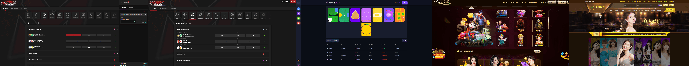

# Sportsbook & Casino Platform

A full-stack software engineering project focused on the architecture and development of modern sports betting and casino platforms.

The project explores scalable web applications, real-time data integration, game management, secure user authentication, and interactive user experiences.

## About the Project

This project demonstrates the technical architecture behind a sportsbook and casino platform, combining sports data services, casino game integrations, backend services, and a responsive frontend.

The primary goal is to explore reliable, maintainable, and scalable software systems for sports and casino applications.




## Core Features

### Sportsbook System
- Sports event and competition management
- Real-time sports data integration
- Event markets and odds management
- Betting slip interface
- Sports event statistics and results
- Backend APIs for sportsbook operations

### Casino System
- Casino game catalog and game management
- Integration architecture for third-party game providers
- Interactive game interfaces
- Game session management
- Transaction processing architecture
- Support for original game development

### Platform Infrastructure
- User authentication and authorization
- RESTful API architecture
- Real-time data communication
- Database management
- Responsive frontend design
- Logging, monitoring, and error handling
- Scalable backend services

## Technology Stack

| Category | Technologies |
|---|---|
| Frontend | React, Next.js, TypeScript |
| Backend | Node.js, Express.js |
| Programming | JavaScript, TypeScript, PHP |
| Database | PostgreSQL, MongoDB |
| APIs | REST APIs, WebSockets |
| Infrastructure | Docker, AWS, Nginx |
| Development | Git, GitHub, CI/CD |

*The technologies listed represent the project's development stack and may vary depending on the implementation.*

## Architecture Overview

```text
                 Frontend Application
                         |
                  API Gateway
                         |
        +----------------+----------------+
        |                |                |
  Sportsbook API     Casino API       User API
        |                |                |
  Sports Data       Game Providers    Authentication
        |                |                |
        +----------------+----------------+
                         |
                    Data Layer
                         |
                PostgreSQL / MongoDB
```

## Engineering Focus

This project focuses on:

- Modular software architecture
- Reliable API integrations
- Real-time data processing
- Secure application development
- Performance optimization
- Maintainable and reusable components
- Scalable backend infrastructure

## Responsible Development

This repository is intended for software engineering, educational, and demonstration purposes.

The project focuses on application architecture, software integrations, and technical implementation.

Any real-money gaming functionality must be developed and operated in accordance with applicable laws, licensing requirements, age restrictions, and responsible gaming standards.

Third-party services and game integrations require appropriate authorization.

## Project Status

🚧 Under Development

Features and architecture may evolve as development progresses.
